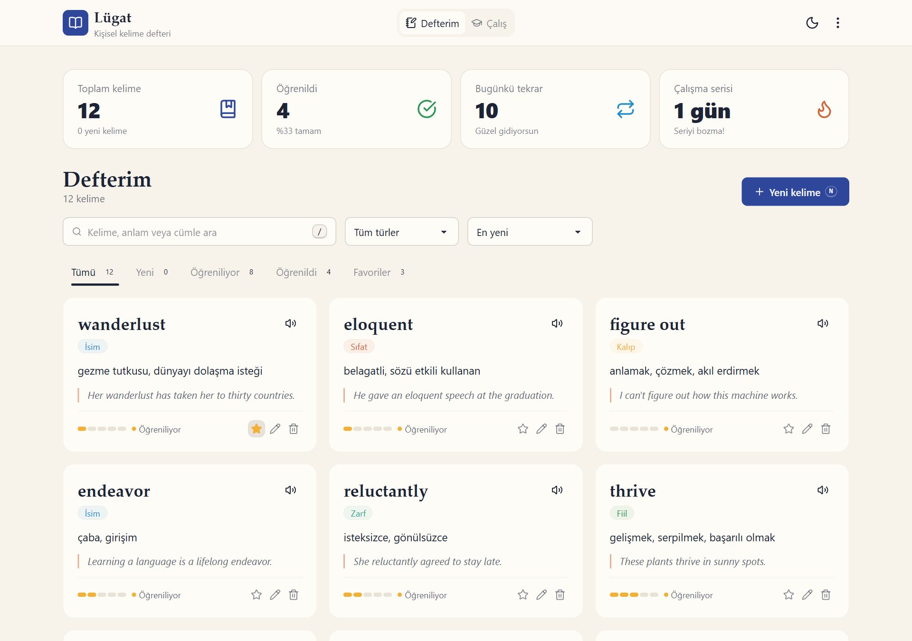
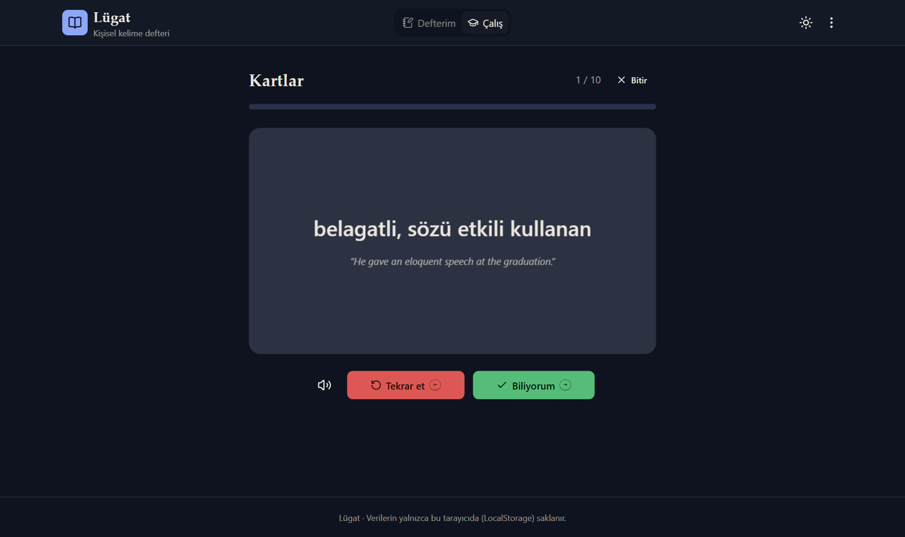
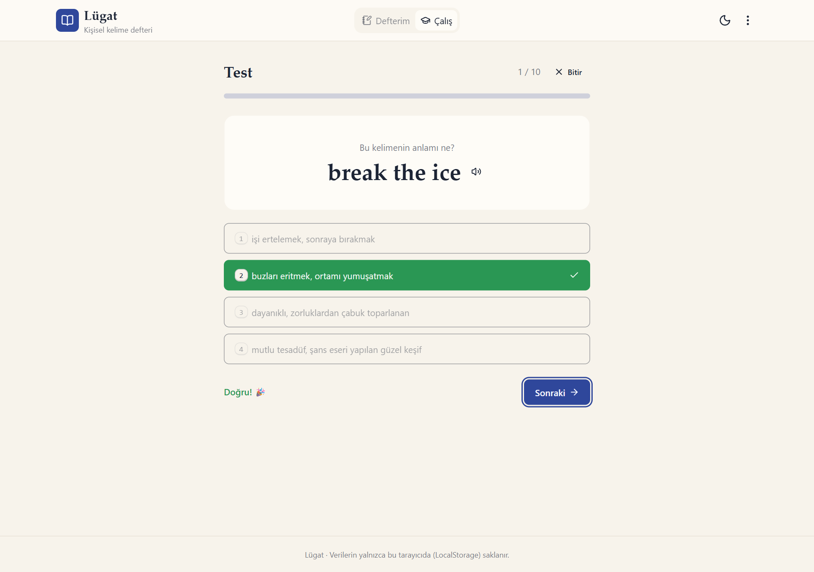
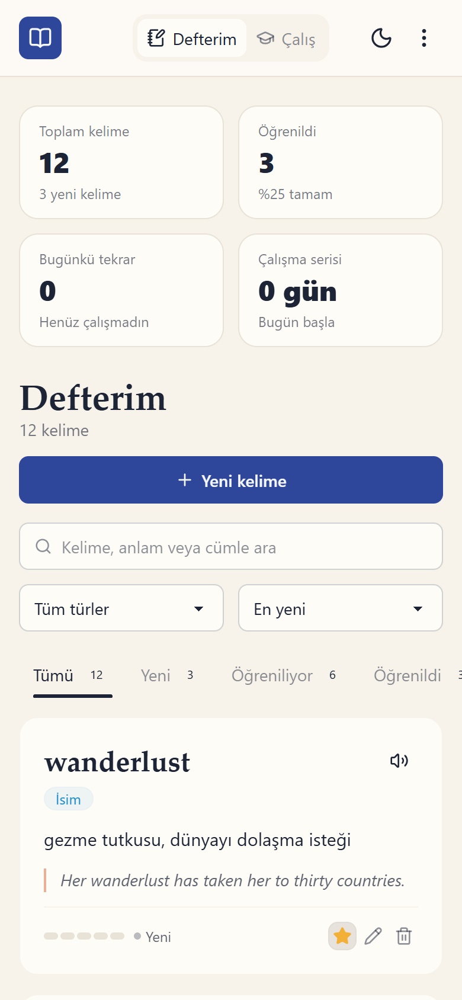

# Lügat · Kişisel Kelime Defteri

Lügat, İngilizce öğrenirken karşılaştığın kelimeleri kaydedip **kartlarla** ve **çoktan seçmeli testlerle** çalışabileceğin bir web uygulamasıdır. Her doğru cevap kelimeyi bir seviye yukarı taşır; beş seviyelik bu sistem sayesinde hangi kelimeleri gerçekten öğrendiğini görürsün. Tüm veriler tarayıcının **LocalStorage** alanında saklanır, sunucu ya da üyelik gerekmez.

> Web Geliştirme – Yapay Zeka Destekli Proje (3. hafta) kapsamında hazırlanmıştır.

**Canlı demo:** https://iberkayyildirim.github.io/lugat-kelime-defteri/
**Kaynak kod:** https://github.com/iBerkayYildirim/lugat-kelime-defteri



| Kart modu (koyu tema) | Test modu | Mobil görünüm |
| --- | --- | --- |
|  |  |  |

## Özellikler

**Defterim**
- Kelime ekleme, düzenleme ve silme (silinen kelime için "Geri al" bildirimi)
- Her kelimede İngilizce terim, Türkçe anlam, tür (isim, fiil, sıfat, zarf, kalıp, diğer) ve örnek cümle
- Türlere göre renkli rozetler, 5 çubuklu öğrenme seviyesi göstergesi
- Kelime, anlam ve örnek cümlede anlık arama (Türkçe `I/ı/İ/i` harflerine duyarlı karşılaştırma)
- Duruma göre filtreleme (Yeni, Öğreniliyor, Öğrenildi, Favoriler), türe göre filtreleme ve 5 farklı sıralama
- Aynı kelimenin iki kez eklenmesini engelleyen kontrol
- Tarayıcının konuşma sentezi (Web Speech API) ile telaffuz dinleme
- Favorilere ekleme

**Çalış**
- **Kartlar:** 3B dönen kart; "Biliyorum" seviyeyi artırır, "Tekrar et" azaltır
- **Test:** Dört şıklı soru; çeldiriciler defterdeki diğer kelimelerden seçilir
- İngilizce → Türkçe veya Türkçe → İngilizce yön seçimi
- Öğrenilmemiş, tüm ya da favori kelimelerle 10, 20 veya tüm kelimelik turlar
- En az bilinen kelimeler önce sorulur
- Tur sonunda başarı yüzdesi, tekrar edilecek kelimeler listesi ve "Yanlışları tekrar et" seçeneği

**Genel**
- Toplam kelime, öğrenilen kelime, günlük tekrar sayısı ve **çalışma serisi (gün)** istatistikleri
- Açık / koyu tema (sistem tercihini algılar, seçimi hatırlar)
- JSON olarak yedek indirme ve yedekten geri yükleme (mevcut kelimelerin üzerine yazmaz)
- Klavye kısayolları: `N` yeni kelime, `/` arama, kartlarda `Boşluk` çevir, `←` / `→` cevap; testte `1–4` şık seç, `Enter` sonraki soru
- Mobil uyumlu arayüz, `#defter` / `#calis` adresleriyle tarayıcının geri tuşu desteği

## Kullanılan teknolojiler

| Alan | Teknoloji |
| --- | --- |
| Kütüphane | [React 19](https://react.dev) (fonksiyon bileşenleri, hook'lar) |
| Derleme aracı | [Vite 8](https://vite.dev) |
| Stil | [Tailwind CSS 4](https://tailwindcss.com) + [daisyUI 5](https://daisyui.com) (özel "lugat" ve "lugat-dark" temaları) |
| İkonlar | [lucide-react](https://lucide.dev) |
| Veri saklama | LocalStorage (`useLocalStorage` özel hook'u) |
| Tarayıcı API'leri | Web Speech API, Blob/File API (yedekleme) |
| Kod kalitesi | [Oxlint](https://oxc.rs) |
| Yayınlama | GitHub Pages (`gh-pages` paketiyle); Netlify için `netlify.toml` hazır |
| Yapay zeka | Claude Code (Claude Opus 5.5) |

## Kurulum

Gereksinim: [Node.js](https://nodejs.org) 20.19 veya üzeri (geliştirme Node 24 ile yapıldı).

```bash
git clone https://github.com/iBerkayYildirim/lugat-kelime-defteri.git
cd lugat-kelime-defteri
npm install
npm run dev
```

Ardından tarayıcıda `http://localhost:5173` adresini aç.

| Komut | Açıklama |
| --- | --- |
| `npm run dev` | Geliştirme sunucusunu başlatır |
| `npm run build` | Yayına hazır dosyaları `dist/` klasörüne üretir |
| `npm run preview` | Üretilen derlemeyi yerelde önizler |
| `npm run lint` | Oxlint ile kod kontrolü yapar |
| `npm run deploy` | Projeyi derler ve `gh-pages` dalına göndererek GitHub Pages'te yayınlar |

## Yayına alma

- **GitHub Pages:** `npm run deploy` komutu projeyi derler ve `dist/` klasörünü [gh-pages](https://www.npmjs.com/package/gh-pages) paketiyle `gh-pages` dalına gönderir. Depo ayarlarında *Settings → Pages → Source* değeri **Deploy from a branch → gh-pages** olarak ayarlıdır. Kodda değişiklik yaptıktan sonra bu komutu tekrar çalıştırmak siteyi günceller.
- **Netlify:** Depoyu Netlify'a bağlaman yeterli; `netlify.toml` derleme komutunu (`npm run build`) ve yayın klasörünü (`dist`) tanımlar.
- `vite.config.js` içindeki `base: './'` ayarı sayesinde aynı derleme hem alt dizinde (GitHub Pages) hem kök dizinde (Netlify/Vercel) çalışır.

## Proje yapısı

```
src/
├── App.jsx                 # Uygulama durumu, kelime işlemleri, tema, yedekleme
├── main.jsx
├── index.css               # Tailwind + daisyUI ve özel temalar
├── components/
│   ├── Header.jsx          # Logo, görünüm sekmeleri, tema düğmesi, veri menüsü
│   ├── StatsBar.jsx        # Özet istatistik kutuları
│   ├── NotebookView.jsx    # Arama, filtreler, sıralama, kelime listesi
│   ├── WordCard.jsx        # Tek kelime kartı
│   ├── LevelMeter.jsx      # 5 seviyeli öğrenme göstergesi
│   ├── WordForm.jsx        # Ekleme / düzenleme penceresi (<dialog>)
│   ├── ConfirmDialog.jsx   # Onay penceresi
│   ├── StudyView.jsx       # Çalışma ayarları ve oturum yönetimi
│   ├── Flashcards.jsx      # Dönen kart modu
│   ├── Quiz.jsx            # Çoktan seçmeli test modu
│   ├── SessionHeader.jsx   # Oturum başlığı ve ilerleme çubuğu
│   ├── SessionSummary.jsx  # Tur sonu özeti
│   └── Toaster.jsx         # Bildirimler
├── hooks/
│   ├── useLocalStorage.js  # LocalStorage ile senkron state
│   └── useToast.js         # Bildirim kuyruğu
├── utils/words.js          # Veri modeli, seviye/durum hesapları, yardımcılar
└── data/sampleWords.js     # İlk açılışta gösterilen örnek kelimeler
```

## Veri modeli

Kelimeler LocalStorage'da `lugat:words` anahtarı altında bir dizi olarak tutulur:

```json
{
  "id": "4f0c…",
  "term": "serendipity",
  "meaning": "mutlu tesadüf, şans eseri yapılan güzel keşif",
  "type": "noun",
  "example": "Finding that tiny bookshop was pure serendipity.",
  "level": 3,
  "correct": 4,
  "wrong": 1,
  "favorite": true,
  "createdAt": 1762700000000,
  "lastReviewed": 1762800000000
}
```

- **Durum:** Hiç çalışılmadıysa *Yeni*, `level >= 4` ise *Öğrenildi*, diğer durumlarda *Öğreniliyor*.
- **Seviye:** Doğru cevapta +1 (en fazla 5), yanlış cevapta −1 (en az 0).
- `lugat:activity` anahtarı gün bazında tekrar sayısını (`{ "2026-11-09": 22 }`) tutar; günlük tekrar ve seri hesabı buradan yapılır.
- `lugat:theme` seçili temayı saklar.

## Yapay zekanın kullanımı

Proje, Claude Desktop uygulamasındaki **Claude Code** (model: Claude Opus 5.5) ile geliştirildi. Proje yönergesi yapay zekaya verildi ve süreç aşağıdaki adımlarla ilerledi:

1. **Planlama:** Yönergedeki örnek fikirlerden "kelime defteri" fikri seçilip genişletildi. Ekranlar (Defterim, Çalış), kelime veri modeli, seviye sistemi ve LocalStorage anahtarları yapay zeka ile birlikte tasarlandı.
2. **Kurulum:** `npm create vite@latest` ile React şablonu oluşturuldu; Tailwind CSS 4, daisyUI 5 ve lucide-react eklendi. Yapay zeka, Tailwind 4'te `tailwind.config.js` yerine CSS tabanlı yapılandırma kullanılması gerektiğini ve daisyUI temasının nasıl tanımlanacağını önerdi.
3. **Bileşen üretimi:** Tüm bileşenler, `useLocalStorage` ve `useToast` hook'ları ile yardımcı fonksiyonlar yapay zeka tarafından yazıldı; erişilebilirlik (aria etiketleri, klavye kısayolları) ve mobil uyum istenerek iyileştirildi.
4. **Hata ayıklama:** Uygulama, yapay zekanın kullandığı yerleşik tarayıcıda adım adım test edildi ve bulunan hatalar düzeltildi:
   - Testte cevap verildikten sonra doğru/yanlış şıklar yeşil/kırmızı yerine soluk görünüyordu. Neden: `aria-disabled` özelliği daisyUI'nin "devre dışı" stilini tetikliyordu. Özellik kaldırılıp tıklama kontrolü JavaScript tarafına alındı.
   - Bir sonraki karta geçerken kart arkası çevrilirken yeni kelimenin cevabı bir anlığına görünebiliyordu. Çözüm: kart elemanına `key` verilerek her yeni kartın sıfırdan, çevrilmemiş olarak oluşturulması.
   - Mobilde logo yazısının kesilmesi, istatistik açıklamalarının kırpılması ve filtre sekmelerindeki sayıların alt satıra kayması düzeltildi.
   - Oxlint'in "render sırasında ref erişimi" uyarısı, menü işleyicileri yeniden düzenlenerek giderildi.
   - Arama ve tekrar kontrolünde Türkçe `I/ı` sorunu için `toLocaleLowerCase('tr')` tabanlı bir `normalize` fonksiyonu yazıldı.
5. **Doğrulama:** Her değişiklikten sonra `npm run lint` ve `npm run build` çalıştırıldı. Ekleme, aynı kelimeyi engelleme, arama, silme/geri alma, kart ve test oturumları, içe aktarma, tümünü silme ve tema değişimi tarayıcıda denendi.
6. **Dokümantasyon:** Bu README'nin taslağı yapay zeka ile hazırlandı. Ekran görüntüleri, uygulamada gerçek bir çalışma turu oynatan bir Playwright betiğiyle otomatik alındı.

Kullanılan istemlere örnekler:

- *"Bu proje yönergesine uygun, React + Vite ile LocalStorage kullanan bir uygulama yap."*
- *"Kelime kartını 3B olarak çeviren bir flashcard bileşeni yaz; boşluk tuşu kartı çevirsin, ok tuşları cevap versin."*
- *"Test modunda çeldiricileri defterdeki diğer kelimelerden seç ve aynı anlama sahip şıkların çıkmasını engelle."*
- *"Uygulamayı mobil genişlikte kontrol et ve taşan ya da kırpılan alanları düzelt."*

## Lisans

Eğitim amaçlı hazırlanmıştır. MIT lisansı ile serbestçe kullanılabilir.
